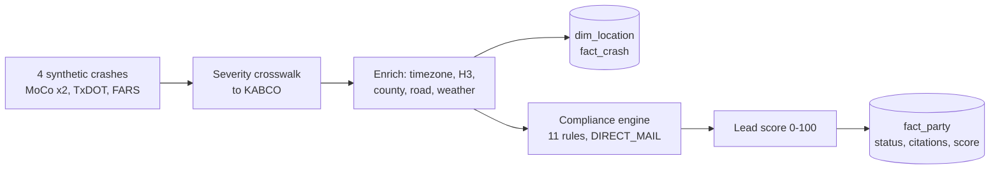

# Crash-to-Contact

A Python prototype that takes public motor-vehicle crash data from three
sources, cleans and normalises it, loads it into a DuckDB star schema, and
decides for each involved party whether they may lawfully be contacted, and
through which channel. Parties that pass the compliance gate are then given a
0-100 lead score.

The main finding is negative: for live calls the answer is almost always "no".
Texas crash reports cannot be used for solicitation at all (Tex. Penal Code
§ 38.12, Tex. Transp. Code § 550.065). Maryland forbids live or automated
phone and SMS outreach outright, and allows direct mail only from day 31
(Md. Bus. Occ. & Prof. § 10-605). FARS records are fatalities. The legal
reasoning is in [COMPLIANCE.md](COMPLIANCE.md) and the business write-up in
[MEMO.md](MEMO.md).

Stack: Python 3.12, DuckDB, Pydantic v2, h3, timezonefinder, pyproj, httpx,
Dagster.

## Sources

| Source | Access | Ingester |
| --- | --- | --- |
| Montgomery County, MD crash reporting (incidents, drivers, non-motorists) | Socrata SODA API, `$order` pagination | `src/ingestion/moco_ingester.py` |
| TxDOT CRIS | ArcGIS FeatureServer, OBJECTID cursor | `src/ingestion/txdot_ingester.py` |
| NHTSA FARS | Annual national CSV ZIPs, SHA-256 restatement check | `src/ingestion/fars_ingester.py` |

Each ingester stores raw pages under `data/raw/` and its cursor under
`data/state/` (`src/ingestion/watermark.py`, atomic write). Both folders are
gitignored.

## What is implemented, and what is a stand-in

The modules under `src/` are covered by unit tests, and the runner and query
CLI by end-to-end tests (76 in total). The runner, `run_pipeline.py`, does
**not** use live data. It loads four fixed
synthetic crashes, one for each compliance outcome, so the result is
reproducible offline.

| Area | State |
| --- | --- |
| Bronze ingestion (`src/ingestion/`) | Real HTTP clients for the three APIs with retry/backoff and watermarks. They need network access and are not called by the tests. |
| Silver transforms (`src/transforms/`) | Implemented and tested: MoCo coordinate envelope, substance-abuse dictionary, report-number disagreement and grain checks; TxDOT coordinate precedence, SCD2 amendments and date parsing; FARS sentinel replacement, restatement diffing and timestamp construction. See [DATA_QUALITY.md](DATA_QUALITY.md). Not yet called by `run_pipeline.py`. |
| Gold schema (`src/models/schema.py`) | DuckDB DDL for `fact_crash`, `fact_party`, `dim_location` and `dim_severity`, plus a KABCO severity crosswalk for all three sources. |
| Entity resolution (`src/models/entity_resolution.py`) | Spatio-temporal matching (distance and time windows, confidence tiers) and greedy clustering. Library only. |
| Compliance engine (`src/compliance/`) | 11 rules: DPPA, Tex. Transp. 550.065, FARS fatality gate, Texas barratry, Maryland live-contact ban, Maryland 30-day blackout, TCPA hours, DNC freshness, Reassigned Numbers DB, wireless PEWC, minors. Each verdict carries a citation code. |
| Lead scoring (`src/scoring/lead_score.py`) | Severity, crash dynamics, vulnerable road user, road class or hotspot, and recency decay after day 30. Ineligible parties always score 0. |
| Timezone | Derived from coordinates with `timezonefinder` (handles El Paso on Mountain time), with bounding-box fallbacks. |
| H3 | Resolution 8 and 9 cells via `h3`. |
| Census enrichment | **Stand-in.** County comes from bounding boxes for five counties (Montgomery MD; Travis, Harris, Dallas, El Paso TX) with hard-coded ACS figures. The tract code is a deterministic placeholder derived from the coordinates, not a TIGER lookup. |
| Road snapping | **Stand-in.** Snaps to three hand-entered Montgomery County segments. Points more than 50 m from all of them get no road. |
| Weather | Normalises the police-reported weather and surface text. No reanalysis archive is queried, so temperature, precipitation and wind are `None`. |
| Spatial statistics (`src/analysis/spatial.py`) | Getis-Ord Gi* and Local Moran's I over H3 neighbour rings, written directly in Python. Library only. |
| Drift detection (`src/contracts/drift_detector.py`) | Schema, volume and null-rate drift checks against a baseline. Library only. |
| Dagster (`orchestration/dagster_definitions.py`) | **Lineage only.** Twelve assets, a job and a daily schedule load in `dagster dev`, but each asset body returns a status dict; none of them call the code above yet. |

## Flow of the demo runner



The evaluation time is fixed at 2024-07-06 12:00 UTC, so the outcome of the
Maryland 30-day blackout does not depend on the day you run it. Re-running the
script replaces the demo rows in the same database file.

## Running it

Everything runs in Docker. The only requirement is Docker itself.

```bash
docker build -t crash-to-contact .

# Demo pipeline; the database is written to ./data on the host
docker run --rm -v "$PWD/data:/app/data" crash-to-contact

# Preset queries against that database (1-5), or any SQL
docker run --rm -v "$PWD/data:/app/data" crash-to-contact python query_db.py --preset 5
docker run --rm -v "$PWD/data:/app/data" crash-to-contact \
  python query_db.py --sql "SELECT state_abbr, count(*) FROM dim_location GROUP BY 1"

# Tests and lint (no network needed)
docker run --rm --network none crash-to-contact pytest -q
docker run --rm --network none crash-to-contact ruff check .

# Dagster UI with the asset lineage, at http://localhost:3000
docker run --rm -p 3000:3000 crash-to-contact \
  dagster dev -f orchestration/dagster_definitions.py -h 0.0.0.0 -p 3000
```

On Linux, add `--user "$(id -u)"` to the commands that mount `./data` if the
container cannot write to it.

Without Docker, use Python 3.12 (see `.python-version`):

```bash
python3.12 -m venv .venv && . .venv/bin/activate
pip install -e ".[dev]"
python run_pipeline.py
python query_db.py            # interactive menu
pytest -q
```

### Sample output

`python run_pipeline.py`:

```text
Crash-to-Contact demo pipeline -> data/crash_analytics.duckdb
Loaded 4 crashes and 4 parties, evaluated at 2024-07-06T12:00:00+00:00 for DIRECT_MAIL.

  party_id source_system state crash_date            severity_name     status  lead_score priority_tier                                     citations            nearest_road    timezone_iana
P_FARS_004          fars    MD 2024-05-15             Fatal Injury INELIGIBLE         0.0  DISQUALIFIED                    NHTSA_FARS_FATALITY_ETHICS                       - America/New_York
  P_MD_001          moco    MD 2024-06-01 Suspected Serious Injury   ELIGIBLE        72.3          HIGH                                               MD 355 / Rockville Pike America/New_York
  P_MD_002          moco    MD 2024-06-24   Suspected Minor Injury INELIGIBLE         0.0  DISQUALIFIED                 MD_BUS_OCC_PROF_10_605_30_DAY                       - America/New_York
  P_TX_003         txdot    TX 2024-06-10 Suspected Serious Injury INELIGIBLE         0.0  DISQUALIFIED TEX_TRANSP_CODE_550_065; TEX_PENAL_CODE_38_12                       -  America/Chicago
```

The Bethesda, Austin and FARS crashes show `-` for road because they are more
than 50 m from the three sample road segments.

### Live ingestion

`python run_pipeline.py --live` first pulls the Montgomery County incidents
dataset into `data/raw/bronze/moco/`, then runs the same demo batch. The
fetched rows are **not** loaded into the gold tables yet. The other ingesters
can be called directly:

```python
from src.ingestion import fars_ingester, moco_ingester, txdot_ingester

moco_ingester.ingest_all()  # all three MoCo datasets
txdot_ingester.ingest()  # TxDOT CRIS FeatureServer
fars_ingester.ingest()  # FARS annual archives
```

## Configuration

Copy `.env.example` to `.env`; `run_pipeline.py` loads it. Both keys are
optional.

| Variable | Used by |
| --- | --- |
| `CENSUS_API_KEY` | `fetch_live_census_acs`. If it is unset, the hard-coded county figures are used. Because tract codes are placeholders, a live lookup will usually find no tract and fall back too. |
| `SOCRATA_APP_TOKEN` | MoCo ingester; raises the anonymous rate limit. |

## Design notes

- **Fail closed.** Every rule returns a verdict with a citation, and a party is
  `ELIGIBLE` only if no rule objects. A missing crash timestamp fails the
  Maryland blackout, and a missing DNC scrub date fails the DNC rule.
- **Timezone from coordinates, not area code.** TCPA calling hours (08:00-21:00)
  are checked in the recipient's local time, taken from the crash location.
- **Flag, don't drop.** Out-of-envelope MoCo coordinates and FARS sentinels are
  flagged or set to NULL rather than deleted, so crash counts stay complete.
- **TxDOT coordinates.** CRIS coordinates win only when `located_fl = 'Y'`;
  otherwise the officer-reported pair is used. Pairs more than 500 m apart are
  flagged as a conflict.

The timestamped decision log is in [DECISIONS.md](DECISIONS.md), and the
record of AI tool use is in [AI_USE.md](AI_USE.md).

## Repository layout

```text
contracts/        Pydantic contracts for bronze records and gold rows
orchestration/    Dagster asset graph (placeholder asset bodies)
output/           sample_leads.csv: a hand-written, fully synthetic example of
                  the lead export format (not produced by run_pipeline.py)
src/analysis/     Gi* and Local Moran's I over H3 cells
src/compliance/   rule engine and statutory rules
src/contracts/    drift detector
src/geo/          CRS, timezone, H3, county lookup, road snap, weather
src/ingestion/    MoCo, TxDOT and FARS ingesters with watermarks
src/models/       DuckDB schema, KABCO crosswalk, entity resolution
src/scoring/      lead scoring
src/transforms/   silver-layer cleaning per source
tests/            pytest suite
run_pipeline.py   demo runner
query_db.py       preset and ad-hoc queries over the DuckDB file
```

## Data and privacy

The repository contains no real crash or personal data. The demo records and
`output/sample_leads.csv` are synthetic, and the demo phone numbers are in the
reserved 555-01xx range. Downloaded data and DuckDB files are gitignored.

## Licence

MIT, see [LICENSE](LICENSE).
